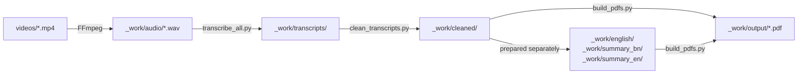

# Video to Transcript Converter (Bangla)

An offline pipeline that turns long Bangla meeting recordings into timestamped transcripts, readable text, and bilingual (Bangla and English) PDF reports. Speech recognition runs locally with [faster-whisper](https://github.com/SYSTRAN/faster-whisper), so no audio is sent to a transcription service.

> **Read this first:** on this project's recordings (on-site audio, heavy Bangla–English code-switching), the Bangla transcripts contain **many recognition errors**. Treat them as rough drafts. Check names and figures against the recording before relying on them. See [Accuracy and limitations](#accuracy-and-limitations).

## Contents

- [What was done](#what-was-done)
- [Pipeline](#pipeline)
- [Repository structure](#repository-structure)
- [Disk space](#disk-space)
- [Setup](#setup)
- [Usage](#usage)
- [Script reference](#script-reference)
- [Model experiments and benchmarks](#model-experiments-and-benchmarks)
- [Full run results](#full-run-results)
- [Accuracy and limitations](#accuracy-and-limitations)
- [Troubleshooting](#troubleshooting)

## What was done

The source material is seven video recordings of an **Adolescent Nutrition Programme review meeting** held on 28 September 2026: about **3 hours 25 minutes** of speech in roughly 15 GB of MP4 files.

1. Extracted the audio from each video as 16 kHz mono WAV.
2. Compared Whisper model sizes and decoding settings on the shortest clip, on both GPU and CPU.
3. Transcribed all seven recordings with `large-v3` on the CPU, using batched inference.
4. Cleaned the raw output by removing junk segments and merging the rest into paragraphs.
5. Prepared an English rendering of each recording, plus short summaries in Bangla and English.
6. Generated two PDF reports: combined transcripts and speech summaries.

## Pipeline



**Translation and summarisation are not automated.** No script in this repository creates the files in `english/`, `summary_bn/` or `summary_en/`. They were prepared separately and are inputs to the PDF builder.

## Repository structure

```text
.
├── README.md
├── .gitignore
├── videos/                      # Put source .mp4 files here (not committed)
└── _work/
    ├── transcribe_all.py        # Main transcription script (large-v3, batched, CPU)
    ├── clean_transcripts.py     # Removes junk segments, builds paragraphs
    ├── build_pdfs.py            # Builds the two PDF reports
    ├── transcribe.py            # Earlier version (small model, CUDA with CPU fallback)
    ├── test_baseline.py         # Experiment: large-v3, sequential, CPU
    ├── test_batched.py          # Experiment: large-v3, batched, CPU
    ├── test_gpu.py              # Experiment: GPU setup, later run as large-v3-turbo on CPU
    ├── test_medium.py           # Experiment: first model trial (currently set to large-v3)
    ├── test_font.py             # Checks Bangla font rendering in a PDF
    ├── *_log*.txt, *_out.txt    # Logs and outputs from the experiments
    ├── *_transcript.txt         # Transcripts from the baseline and batched tests
    ├── transcripts/             # Raw timestamped transcripts
    ├── cleaned/                 # Cleaned Bangla paragraphs
    ├── english/                 # English renderings
    ├── summary_bn/              # Bangla summaries
    ├── summary_en/              # English summaries
    ├── fonts/                   # Nirmala fonts used for Bangla text in PDFs
    ├── output/                  # Generated PDFs
    ├── audio/                   # Extracted WAV files (not committed)
    ├── hf_cache/                # Downloaded models (not committed)
    └── venv/                    # Python virtual environment (not committed)
```

## Disk space

| Item | Size |
|---|---|
| `large-v3` model | 2.9 GB |
| All four models tried (`small`, `medium`, `large-v3`, `large-v3-turbo`) | About 6.3 GB |
| Virtual environment (including NVIDIA libraries) | About 2.3 GB |
| Extracted WAV audio for this project | About 377 MB |

## Setup

> **Paths are hard-coded.** The scripts expect the project at `D:/vid_to_audio`. Either clone it there, or edit the path constants at the top of each script (`AUDIO_DIR`, `OUT_DIR`, `SRC_DIR`, `BASE`).

The commands below are for **PowerShell**.

Clone the repository:

```powershell
git clone https://github.com/khrahaman/Video_to_Transcript_Converter_-Bangla_Language-.git D:\vid_to_audio
```

Move into the project and create a virtual environment:

```powershell
cd D:\vid_to_audio
python -m venv _work\venv
```

Install the Python packages:

```powershell
_work\venv\Scripts\python.exe -m pip install faster-whisper==1.2.1 reportlab==5.0.1
```

Install FFmpeg if you do not already have it:

```powershell
winget install Gyan.FFmpeg
```

Set the model cache location and force UTF-8 output. These apply to the current terminal session:

```powershell
$env:HF_HOME = "D:\vid_to_audio\_work\hf_cache"
$env:PYTHONUTF8 = "1"
```

`transcribe_all.py` does not set `HF_HOME` itself. Without the line above, models go to the default Hugging Face cache in your user profile, usually on drive C:.

## Usage

### 1. Add the videos

Copy your `.mp4` files into `videos/`.

### 2. Extract the audio

This produces the format used in this project (16 kHz, mono, 16-bit PCM):

```powershell
New-Item -ItemType Directory -Force _work\audio | Out-Null
Get-ChildItem videos\*.mp4 | ForEach-Object { ffmpeg -i $_.FullName -vn -ac 1 -ar 16000 -c:a pcm_s16le "_work\audio\$($_.BaseName).wav" }
```

### 3. Transcribe

```powershell
_work\venv\Scripts\python.exe _work\transcribe_all.py
```

- The first run downloads the `large-v3` model.
- On the hardware above, expect about **4 hours of processing per hour of audio**.
- Files that already have a transcript are skipped, so you can stop and restart. An interrupted file may leave a partial transcript: delete it before restarting.

Each transcript starts with the language line, followed by one line per segment with start and end times in seconds:

```text
lang: bn 1
[0.3-29.0] <Bangla text>
[29.3-59.6] <Bangla text>
```

### 4. Clean the transcripts

```powershell
_work\venv\Scripts\python.exe _work\clean_transcripts.py
```

This overwrites the files in `_work/cleaned/`.

### 5. Add translations and summaries

For each recording, create UTF-8 text files with the same base name:

| Folder | Content |
|---|---|
| `_work/english/<name>.txt` | English translation. Separate paragraphs with a blank line. Paragraphs starting with `[Note:` or `[Video` are styled as notes. |
| `_work/summary_bn/<name>.txt` | Summary in Bangla, as one paragraph |
| `_work/summary_en/<name>.txt` | Summary in English, as one paragraph |

### 6. Build the PDFs

Before running this for new recordings, edit the `SPEECHES` list in `build_pdfs.py`. Each entry holds the file name, recording time, duration and title. Also update the report headings, date and disclaimer text in the same file.

```powershell
_work\venv\Scripts\python.exe _work\build_pdfs.py
```

The PDFs are written to `_work/output/`, replacing any existing ones.

## Script reference

### `transcribe_all.py`

The main transcription script.

| Setting | Value | Purpose |
|---|---|---|
| Model | `large-v3` | The model chosen for the final run |
| Device and precision | CPU, `int8` | The GPU test ran out of memory |
| `cpu_threads` | 4 | Number of CPU threads used |
| Pipeline | `BatchedInferencePipeline` | Faster than sequential decoding in tests |
| `batch_size` | 8 | Segments decoded together |
| `beam_size` | 5 | Beam search width |
| `language` | `bn` | Forces Bangla instead of auto-detection |
| `vad_filter` | `True` | Skips non-speech audio; batched mode here requires it |
| `condition_on_previous_text` | `False` | Intended to stop errors carrying into later segments |

Its `collapse_repeats` function limits a word repeated back-to-back to three occurrences, which trims a common Whisper failure.

### `clean_transcripts.py`

- Drops the language line, timestamps and Unicode replacement characters.
- Removes segments judged to be junk: empty or `...` lines, segments of three or more words with at most two distinct words, and long single tokens made of a repeating 2–4 character pattern.
- Joins every five remaining segments into a paragraph.

These are simple rules. They remove obvious noise but do not correct recognition errors.

### `build_pdfs.py`

Uses ReportLab to create A4 documents with a title page, a disclaimer, and one section per recording. Bangla text uses the Nirmala font; English text uses Helvetica.

### `transcribe.py`

An earlier script using the `small` model, trying CUDA (`int8_float16`) first and falling back to CPU if the model fails to load. It writes to the same `transcripts/` folder and skips existing files, as the main script does. **Do not run both on the same recordings** unless you clear that folder in between.

## Model experiments and benchmarks

All timings below use the first recording, `20260928_100728` (161.5 seconds), and exclude model loading. They are single runs on one laptop, so treat them as indicative.

| Test | Model | Settings | Time | Relative to audio length | Log |
|---|---|---|---|---|---|
| Baseline | `large-v3` | CPU, sequential, beam 5, no VAD | 2022.0 s | 12.5× | `baseline_log.txt` |
| Batched | `large-v3` | CPU, batch 8, beam 5, VAD | 268.0 s, 295.4 s, 672.7 s | 1.7× to 4.2× | `batched_test_log*.txt` |
| Final run | `large-v3` | Same batched settings | 640.3 s | 4.0× | `transcribe_all_log.txt` |
| Turbo | `large-v3-turbo` | CPU, sequential, beam 1, no VAD | 457.4 s | 2.8× | `turbo_test_log.txt` |
| GPU | See `test_gpu.py` | CUDA, GTX 1050 | Failed | — | `gpu_test_log*.txt` |

Findings:

- **GPU:** both logged attempts stopped with `CUDA failed with error out of memory`. The 4 GB card was not enough for the configuration tested.
- **Batching:** every batched run was much faster than the sequential baseline. The batched timings varied widely between runs, and the logs do not record why.
- **Turbo:** `large-v3-turbo` on this clip, with beam size 1, produced text with long repeated fragments (see `test_gpu_out.txt`).
- **Early trial:** `test_medium_out.txt` shows output that mixes several unrelated scripts and is unusable. The script has since been edited, so the exact settings behind that file are not recorded.

## Full run results

Final run with `large-v3` and batched CPU inference:

| # | Recording | Title (inferred) | Audio length | Processing time | Ratio |
|---|---|---|---|---|---|
| 1 | `20260928_100728` | Opening Remarks | 2 min 42 s | 10 min 40 s | 4.0× |
| 2 | `20260928_101025` | Nutrition International: Programme Overview | 14 min 6 s | 45 min 55 s | 3.3× |
| 3 | `20260928_102437` | Adolescent Empowerment & Awareness | 4 min 15 s | 16 min 38 s | 3.9× |
| 4 | `20260928_103027` | District Data Review & Technical Discussion | 57 min 46 s | 4 h 2 min 51 s | 4.2× |
| 5 | `20260928_114807` | District Implementation & Extended Discussion (Jamalpur) | 83 min 52 s | 5 h 14 min 48 s | 3.8× |
| 6 | `20260928_131213` | National Policy, Fortification & Coordination | 37 min 58 s | 2 h 15 min 42 s | 3.6× |
| 7 | `20260928_135016` | Closing Remarks | 4 min 47 s | 18 min 51 s | 3.9× |
| | **Total** | | **3 h 25 min** | **About 13 h 5 min** | **3.8×** |

Titles are descriptive labels inferred from the content, not official session titles.

## Accuracy and limitations

- **Transcription quality is low in many places.** Source audio quality, accent and frequent switching between Bangla and English made parts unintelligible to the model.
- **The English text is not a verbatim translation.** It is a best-effort rendering of the discernible meaning. For the long sessions it is grouped by theme and is much shorter than the Bangla transcript. Unclear passages are noted or omitted.
- **Names and numbers are unverified.** Check them against the recording before citing them.
- **No accuracy measurement was made.** There is no reference transcript, so no word error rate is available.
- **Not a general-purpose tool yet.** Paths, language and report metadata are hard-coded, and there is no command-line interface.
- **PDF text is not escaped.** Characters such as `<` or `&` in the input text can break or distort PDF generation.

Possible improvements: cleaner source audio (an external or lapel microphone), audio pre-processing such as noise reduction, trying a Bangla fine-tuned speech model, a larger GPU, and configurable paths and settings.

## Troubleshooting

| Problem | Cause and fix |
|---|---|
| `UnicodeEncodeError: 'charmap' codec can't encode characters` | The Windows console is using `cp1252`. Set `$env:PYTHONUTF8 = "1"`, or write to a UTF-8 file instead of printing. |
| `RuntimeError: No clip timestamps found` | Batched transcription needs `vad_filter=True` or explicit `clip_timestamps`. |
| `CUDA failed with error out of memory` | Use `device="cpu"` with `compute_type="int8"`, or try a smaller model or batch size. |
| Hugging Face symlink warning | Harmless. The cache works but may use more disk space. Windows Developer Mode enables symlinks. |
| Drive C: fills up | Set `HF_HOME`, and `PIP_CACHE_DIR` if needed, to a folder on another drive. Keep cache folders out of Git. |
| A recording is skipped | A transcript with that name already exists in `_work/transcripts/`. Delete it to transcribe again. |

## Data, fonts and licensing

- Source videos and extracted audio are excluded from Git by `.gitignore`.
- Nirmala is a Microsoft font supplied with Windows. Its licence is separate from this project; check the terms before redistributing the font files.
- No licence file is currently included for the code.
